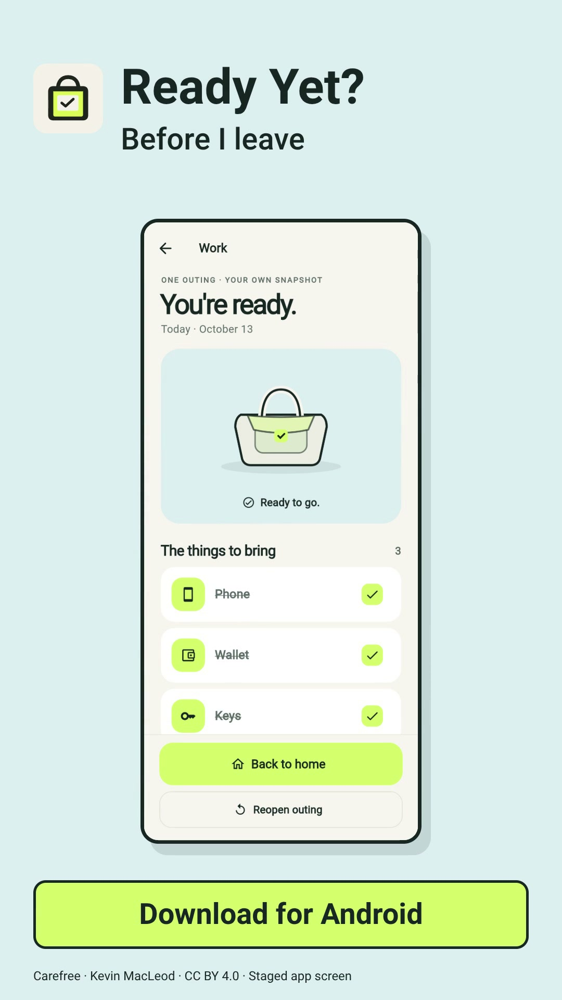

# Ready Yet?

**Before I Leave** is the tagline for Ready Yet?, an offline Android checklist for the things you want with you before heading out. Lists and outings stay in the app’s private storage. No account, network service, ads, analytics, subscription, or purchase is required.

Choose School, Work, Gym, Trip, or a custom list. Check items as you pack, resume unfinished outings, and keep reusable list edits separate from outings already in progress. Recurring weekday schedules create independent daily checklists with optional departure reminders and Open, Snooze and Skip actions. A scheduled-checklist widget follows today’s actual occurrence with progress, due/next time, safe item checks and direct-open. Compact 2×2 checklist and Quick lists widgets retain larger layouts. The ID card/Perfume icons, Back to home completion flow, Pack for today shortcut, themes and reduced motion are included.

## Watch the ad

**The keys are still inside** · 18 seconds

<a href="https://raw.githubusercontent.com/FrancisGiann/ready-yet/main/docs/media/ads/Ready-Yet-The-Keys-Are-Still-Inside.mp4">
  
</a>

[Watch or download the ad (MP4)](https://raw.githubusercontent.com/FrancisGiann/ready-yet/main/docs/media/ads/Ready-Yet-The-Keys-Are-Still-Inside.mp4) · [View file on GitHub](docs/media/ads/Ready-Yet-The-Keys-Are-Still-Inside.mp4) · [Caption and credits](docs/media/ads/Ready-Yet-The-Keys-Are-Still-Inside-caption.txt)

An illustrated leaving-home story ends with the actual Ready Yet? icon, a staged app completion screen and the tagline **Before I leave**.

Music: [Carefree](https://incompetech.com/music/royalty-free/index.html?Search=Search&isrc=USUAN1400037) by Kevin MacLeod ([incompetech.com](https://incompetech.com/)), [CC BY 4.0](https://creativecommons.org/licenses/by/4.0/). Trimmed, normalized, faded and mixed, with a brief narrative volume dip. Full credits are linked above.

## Build

Requirements: Flutter 3.47.2 or compatible, Android SDK 36, and a JDK supported by the Android Gradle Plugin (17 or newer). The app supports Android 7.0 (API 24) and newer.

```sh
flutter pub get
flutter analyze
flutter test
android/qa/check_widget_policy.sh
android/qa/check_reminder_time.sh
android/qa/check_schedule_time.sh
flutter build apk --release --target-platform android-arm64 --no-tree-shake-icons --no-pub
```

The Gradle configuration currently signs release-mode builds with the local Android debug key for personal sideload testing. No signing key is included. For store or other public distribution, configure your own release signing key through local or CI secrets; keep key files and passwords outside the repository. A debug-signed APK is not a Play Store release.

## Verification

The scheduled-widget candidate passed 94 Flutter tests and 227 focused Java widget policy assertions. The final 1.0.6+7 About metadata correction passed 12 focused Flutter checks and clean analysis, followed by a fresh signed Android release build and release lint (zero errors, 94 warnings). Seven synthetic Robolectric API 35 tests exercise release-compiled native classes with packaged APK resources, including desired-value check delivery/replay, stale epoch/binding/day rejection, exact quick-open, timezone refresh, DST occurrence selection and the actual installed package version read. The About footer displays installed version/build metadata, verified as 1.0.6+7 in light/dark host captures. Fourteen native captures cover 110–349dp layouts, long labels, light/dark configurations and font scales 1×–3×. See [1.0.6 notes](docs/UPDATE_1_0_6.md) and [schedule implementation](docs/SCHEDULES_IMPLEMENTATION.md).

The arm64 APK retains package `dev.giann.before_i_leave`, increases version code from 6 to 7 and matches the existing signing certificate. Signature/package checks support upgrade compatibility; an in-place installation on a physical device or emulator was not performed. No configured emulator/system image or attached device was available. Synthetic checks do not establish OEM launcher, TalkBack, Doze, reboot or real background-alarm delivery behavior. Minimum-size/large-text labels can ellipsize; full widget details remain in accessibility descriptions and the app. Existing schedules, occurrence history, manual widgets and reminders are retained. No location permission or tracking was added.
