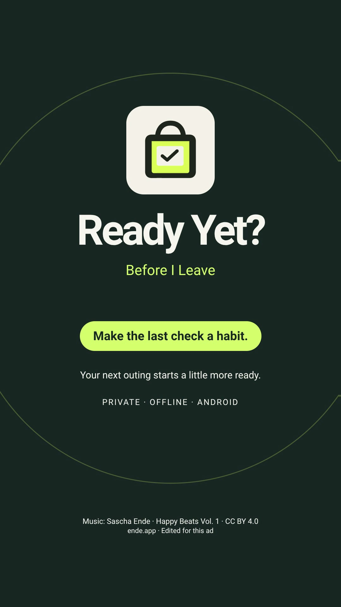

# Ready Yet?

**Before I Leave** is the tagline for Ready Yet?, an offline Android checklist for the things you want with you before heading out. Lists and outings stay in the app’s private storage. No account, network service, ads, analytics, subscription, or purchase is required.

Choose School, Work, Gym, Trip, or a custom list. Check items as you pack, resume unfinished outings, and keep reusable list edits separate from outings already in progress. Optional local reminders, checklist and Quick lists widgets, a Pack for today shortcut, themes, and reduced motion are included.

## Watch the ad

**Before I Leave** · 22 seconds

<a href="https://raw.githubusercontent.com/FrancisGiann/ready-yet/main/docs/media/Ready-Yet-before-I-leave.mp4">
  
</a>

[Download the ad (MP4)](https://raw.githubusercontent.com/FrancisGiann/ready-yet/main/docs/media/Ready-Yet-before-I-leave.mp4) · [View file on GitHub](docs/media/Ready-Yet-before-I-leave.mp4) · [Caption and credits](docs/media/Ready-Yet-caption-and-credits.txt)

Music: “Happy Beats & Business Moves Vol. 1” by Sascha Ende, [CC BY 4.0](https://creativecommons.org/licenses/by/4.0/). Trimmed, normalized, faded and mixed for this ad.

## Build

Requirements: Flutter 3.47.2 or compatible, Android SDK 36, and a JDK supported by the Android Gradle Plugin (17 or newer). The app supports Android 7.0 (API 24) and newer.

```sh
flutter pub get
flutter analyze
flutter test
android/qa/check_widget_policy.sh
android/qa/check_reminder_time.sh
flutter build apk --release --target-platform android-arm64 --no-tree-shake-icons --no-pub
```

The Gradle configuration currently signs release-mode builds with the local Android debug key for personal sideload testing. No signing key is included. For store or other public distribution, configure your own release signing key through local or CI secrets; keep key files and passwords outside the repository. A debug-signed APK is not a Play Store release.

## Verification

Prior verification recorded 64 passing Flutter tests with clean analysis, 96 pure-Java native policy assertions, and nine native widget XML captures rendered with Layoutlib. One capture uses a title TextView fallback in the renderer fixture. These checks do not include a physical phone, emulator, or launcher runtime test; Layoutlib and Flutter test renders cannot establish OEM widget behavior. The nine layouts are generated QA output and are not included in this source repository. Generated APKs and source archives are also kept out.
